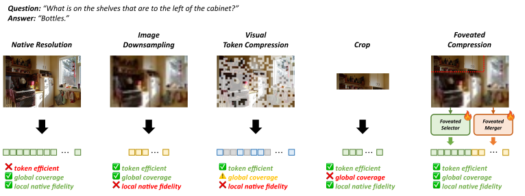
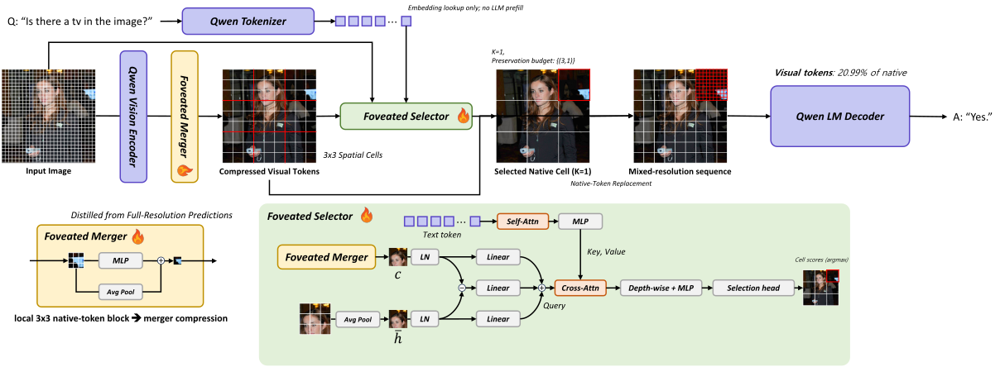

<div align="center">

# Foveated Compression: Selective High-Resolution Preservation for Token-Efficient VLMs

**[Donghyun Han](https://donghyun99.github.io/cv/)**<sup>1\*†</sup>, **[Jangho Park](https://github.com/pjh0846)**<sup>2\*</sup>, **Yuseok Bae**<sup>1</sup>

<sup>1</sup>ETRI, South Korea &nbsp;&nbsp; <sup>2</sup>Kyung Hee University, South Korea

<sup>\*</sup>Equal contribution &nbsp;&nbsp; <sup>†</sup>Corresponding author

**[NeurIPS 2026 Workshop: VLM4RWD](https://vlm4rwd.github.io/)**<br>
<sub>Grounded and Faithful Vision-Language Models for Real-World Deployment</sub>

[](https://arxiv.org/abs/2610.07729)
[](assets/paper/poster.pdf)
[](https://donghyun99.github.io/Foveated-Compression/)

</div>

## ✨ TL;DR

Under a fixed visual-token budget, *where* should a VLM keep native resolution? We study this question with **Foveated Compression**, which encodes an image once and mixes native and compressed tokens in a single sequence.

<p align="center">
  
</p>
<p align="center"><sub>Downsampling and token compression lose local detail, and cropping loses global coverage. Foveated Compression keeps one selected region at native fidelity and the rest compressed, all from a single full-resolution encoding.</sub></p>

Our contributions:

- 🧩 **A mixed-resolution representation.** A behaviorally self-distilled *Foveated Merger* compresses each 3×3 token block while staying compatible with native tokens, so any region can be restored at native fidelity without re-encoding the image.
- 🎯 **A controlled testbed for spatial fidelity allocation.** Exhaustive, budget-matched K=1 interventions with tie-aware supervision let us compare learned, random, fixed, and oracle region choices at the *same* token cost.
- 🔬 **A diagnosis of what limits it.** Learned allocation beats random and fixed regions but still trails strong whole-image resizing, while a budget-matched oracle leaves large headroom (82.73 vs. 69.61). Signals that predict compression failure appear mostly after language-model computation, pointing to region selection and compressed-region fidelity as open problems.

## 🔥 News

- **[2026.11.18]** Code is released.
- **[2026.10.01]** Foveated Compression is accepted to the [NeurIPS 2026 Workshop: VLM4RWD](https://vlm4rwd.github.io/).

## 📝 Abstract

Visual tokens are a major source of inference cost in vision-language models, yet simple image downsampling remains a surprisingly strong compression baseline. This raises a complementary question: under a fixed token budget, where should visual fidelity be preserved? We introduce Foveated Compression, which encodes a full-resolution image once and represents it with a mixture of native- and compressed-resolution visual tokens. A behaviorally self-distilled Foveated Merger compresses local visual tokens while preserving compatibility with their native counterparts, and a lightweight Foveated Selector chooses one of nine spatial cells to retain at native resolution using exhaustive budget-matched intervention supervision. Token budgets count visual tokens entering the language model, which govern prefill cost and KV-cache memory; the vision encoder still runs once at full resolution. At 11.11% visual tokens, uniform Foveated Compression shows no significant paired difference from iso-token downsampling. At 20.99%, the learned selector significantly outperforms random and fixed allocation, but remains below strong whole-image resizing, showing that localized fidelity is not universally preferable. Within the same 3×3, K=1 action space, a budget-matched region-choice oracle reaches 82.73 macro accuracy versus 69.61 for the learned selector, revealing substantial unrealized headroom. Matched probing further shows that signals predicting when compression breaks the answer are substantially more accessible after language-model computation than to the lightweight prefill-free selector. These results expose complementary bottlenecks in region selection and compressed-region fidelity.

## 💡 Method

<p align="center">
  
</p>

- **Foveated Merger** compresses each 3×3 block of native visual tokens into one token (11.11% of native), trained by behavioral self-distillation from the frozen model's own answers.
- **Foveated Selector** ranks nine coarse cells from native tokens, compressed tokens, and question embeddings, supervised by exhaustive budget-matched K=1 interventions.
- **Mixed-resolution sequence**: the selected cell is restored with native tokens in place, at exactly 17/81 = 20.99% of native tokens.

See the [project page](https://donghyun99.github.io/Foveated-Compression/) for diagnostics, probing analysis, and qualitative examples.

## 📊 Main Results

Qwen2.5-VL-7B-Instruct, 37,610 examples across eight benchmarks. MME is divided by 28 for the macro average only.

| Method | Tokens | GQA | MMB-E | MMB-C | MME | POPE | MMStar | OCR | ChartQA | Macro |
|---|---|---|---|---|---|---|---|---|---|---|
| Native | 100.00% | 60.97 | 86.86 | 85.61 | 2356.7 | 87.74 | 60.93 | 80.20 | 84.28 | 78.85 |
| Uniform Foveated Compression | 11.11% | 58.28 | 82.51 | 82.01 | 2130.5 | 84.34 | 50.20 | 49.30 | 34.24 | 64.62 |
| Iso-Token Downsample | 11.11% | 55.88 | 82.77 | 81.75 | 2240.8 | 82.69 | 51.07 | 57.30 | 27.44 | 64.86 |
| Random K=1 | 20.99% | 58.40 | 84.18 | 82.86 | 2190.7 | 84.34 | 52.33 | 55.10 | 48.36 | 67.98 |
| Fixed K=1 | 20.99% | 58.90 | 83.69 | 82.70 | 2170.3 | 84.54 | 51.87 | 53.70 | 54.92 | 68.48 |
| **Foveated Selector** | 20.99% | 58.24 | 84.59 | 82.67 | 2186.7 | 84.92 | 52.13 | 58.40 | 57.84 | **69.61** |
| Matched-Budget Downsample | 19.82% | 58.05 | 84.45 | 83.34 | 2303.0 | 84.77 | 54.53 | 67.00 | 53.48 | 70.99 |
| 2× Downsample | 24.57% | 58.82 | 85.12 | 84.15 | 2298.7 | 84.90 | 56.00 | 70.50 | 57.84 | 72.43 |
| K=1 Region-Choice Oracle | 20.99% | 70.42 | 92.22 | 90.85 | 2500.8 | 91.82 | 70.67 | 77.60 | 78.92 | 82.73 |

## ⚙️ Setup

```bash
git clone https://github.com/Donghyun99/Foveated-Compression.git
cd Foveated-Compression
pip install -r requirements.txt   # frozen environment used for the reported runs
pip install flash-attn --no-build-isolation   # default attention backend (config.BACKBONE)
```

The frozen backbone is [`Qwen/Qwen2.5-VL-7B-Instruct`](https://huggingface.co/Qwen/Qwen2.5-VL-7B-Instruct). All paper settings (Table A1, evaluation protocol, benchmarks) are defined in `config.py`. Run every command from the repository root.

## 🚀 Usage

### 🏋️ Train

Training is sequential: the Foveated Merger is trained and frozen first, then the Foveated Selector is trained on exhaustive K=1 intervention labels measured with that merger.

```bash
# Teacher cache: the native model's greedy answers + top-256 log-probs (one shard per GPU)
for i in $(seq 0 7); do
  CUDA_VISIBLE_DEVICES=$i python cli.py dump-teacher \
    --shard-idx $i --num-shards 8 --out teacher/shard$i.npz &
done; wait
python cli.py dump-teacher --report --out 'teacher/*.npz'   # coverage + retained top-k mass

# Stage 1: behavioral self-distillation of the Foveated Merger (8 GPUs)
torchrun --nproc_per_node 8 cli.py train-merger \
  --teacher-dump 'teacher/*.npz' --out ckpt/merger.pt

# Selector supervision: all nine K=1 actions on the training splits (one shard per GPU)
for i in $(seq 0 7); do
  CUDA_VISIBLE_DEVICES=$i python cli.py label --merger ckpt/merger.pt \
    --shard-idx $i --num-shards 8 --out-json labels/shard$i.json &
done; wait

# Stage 2: tie-aware training of the Foveated Selector
python cli.py train-selector --merger ckpt/merger.pt \
  --labels 'labels/*.json' --out ckpt/selector.pt
```

Ablations (Table 2): `--single-winner` (single-winner supervision) and `--no-question` (question and spatial inputs removed) on `train-selector`.

### 🧪 Test

Evaluates the Table 1 conditions on GQA, MMBench-en/cn, MME, POPE, MMStar, OCRBench, and ChartQA.

```bash
python cli.py eval --merger ckpt/merger.pt --selector ckpt/selector.pt \
  --fixed-cell-labels 'labels/*.json' \
  --conditions native,uniform,iso_token_downsample,random_k1,fixed_k1,selector,matched_budget_downsample,downsample_2x,oracle_k1 \
  --out-json results/records.json --out-summary results/summary.json
```

## 🙏 Acknowledgement

This work was supported by a grant from the Institute of Information & Communications Technology Planning & Evaluation (IITP) grant funded by the Korean government (MSIT) (No. RS-2022-II220124, Development of Artificial Intelligence Technology for Self Improving Competency-Aware Learning Capabilities) and Electronics and Telecommunications Research Institute (ETRI) grant funded by the Korean government (26CB1200, Development and Application of Science-Specialized Multimodal Foundation Models).

This codebase is built on [Qwen2.5-VL](https://github.com/QwenLM/Qwen2.5-VL) and uses benchmark data hosted by [lmms-lab](https://huggingface.co/lmms-lab).

## 📚 Citation

```bibtex
@inproceedings{han2026foveated,
  title     = {Foveated Compression: Selective High-Resolution Preservation for Token-Efficient VLMs},
  author    = {Donghyun Han and Jangho Park and Yuseok Bae},
  booktitle = {NeurIPS 2026 Workshop: VLM4RWD},
  year      = {2026},
  note      = {arXiv:2610.07729}
}
```
